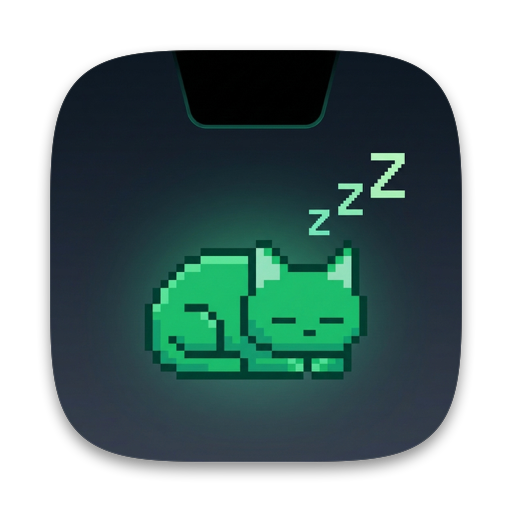

<h1 align="center">
  <br>
  
  <br>
  zzz.notch
  <br>
</h1>

<p align="center">
  Personal macOS notch developer HUD — pixel mascots for live coding agents, interactive notch prompts, plus music, calendar, shelf, and system OSD.
</p>

<p align="center">
  <a href="https://github.com/habibmufti/zzz.notch/actions/workflows/cicd.yml">
    
  </a>
  <a href="LICENSE">
    
  </a>
</p>

---

## Features

### Dev HUD
- **Pixel Mascots in the Notch**: One animated 16×16 pixel mascot (`blob`, `robot`, or `cat`) per active agent session — typing, searching, building, pushing, reading, jumping when waiting for input, celebrating on completion, and dozing off with drifting `z`s when idle.
- **2-Line Closed-Notch Peek & Dev Tab Card**: Shows status pill, active prompt, current step (`NOW` + tool badge + shortened path), subagent badge & list, context window usage bar, `LAST RESULT` highlight, `BEFORE THAT` history, and instant session switcher.
- **Interactive Prompts (`zzz ask`)**: Answer single-choice or multi-choice agent questions directly in the notch via clicks or `⌃⌥⌘1…6`.
- **Exact Jump & Auto-Cleanup**: Click a session header or `↗` to jump straight to the exact VS Code/Cursor workspace (`--url`) or tmux pane (`--tmux`). Dead session PIDs are reaped automatically (`--pid`).
- **Full-Screen Mode**: Configurable under **Settings → Dev → Full screen** (`Urgent only`, `Dim mascots`, `Hide completely`, `Show normally`).
- **In-App CI Updater**: Check and install the latest GitHub Actions build straight from the Menu Bar or **Settings → About**, with automatic local re-signing so macOS permissions persist across updates.

### Core Notch Features (Retained from `boring.notch`)
- **Music & Visualizer**: Now Playing live activity, album artwork, playback controls, and mascot music reactions.
- **Calendar & Reminders**: Upcoming events and meeting links in the notch.
- **File Shelf**: Drag-and-drop shelf with AirDrop / sharing support.
- **System OSD Replacement**: Custom notch HUD for volume, display brightness, and keyboard backlight.

---

## Installation

Builds are produced by GitHub Actions ([`.github/workflows/cicd.yml`](.github/workflows/cicd.yml)) and installed locally via [`tools/install.sh`](tools/install.sh), which re-signs the bundle with your local code-signing identity so macOS Accessibility / Calendar grants persist across updates.

### Prerequisites
- macOS 15.6+ (Apple Silicon or Intel)
- [GitHub CLI (`gh`)](https://cli.github.com/) authenticated to this repo
- A local code-signing certificate in your Keychain (e.g. a self-signed Code Signing cert created in Keychain Access)

### Install / Update from Latest CI

```bash
./tools/install.sh
```

Or specify a specific CI run ID / signing identity:

```bash
ZZZ_SIGN_IDENTITY="Your Signing Cert" ./tools/install.sh [RUN_ID]
```

Once installed, future updates can be triggered directly from the **Menu Bar** or **Settings → About → Update from Latest CI…**.

---

## CLI (`tools/zzz`)

Symlink `tools/zzz` onto your `PATH` (for example `~/.local/bin/zzz`):

```bash
mkdir -p ~/.local/bin
ln -sf "$PWD/tools/zzz" ~/.local/bin/zzz
```

### Commands

```bash
# Push a notification or update an ongoing dev session
zzz notify "title" ["body"] \
  [--status info|ok|fail|wait|run|idle] \
  [--source NAME] [--symbol SF_SYMBOL] [--id KEY] \
  [--app BUNDLE_ID] [--url URL] [--tmux PANE] \
  [--pid PID] [--context 0..100] [--duration SECONDS] \
  [--activity type|search|build|push|read] \
  [--now "headline"] [--intent "why"] [--command "raw"] [--detail "step"] \
  [--step "plan position"] [--prompt "task"] \
  [--agents N] [--agent-list $'name · task\n...']

# Clear an ongoing session immediately
zzz clear --id KEY

# Ask a 1–6 option question in the notch and print chosen option(s) to stdout
zzz ask "Deploy to staging?" --id deploy \
  --option "Yes" --option "No" [--multiple] [--timeout 120]
```

`run`, `wait`, and `idle` maintain an ongoing mascot keyed by `--id`. `ok` and `fail` on an active `--id` let its mascot react for 4 seconds before clearing automatically. `zzz` exits `0` even if `zzz.notch` is not running, so hooks never break their caller.

---

## Agent Hooks

### Antigravity (`tools/hooks/agy-zzz-notch.py`)

Add to `~/.gemini/config/hooks.json` (global) or `.agents/hooks.json` (workspace):

```json
{
  "zzz-notch": {
    "PreInvocation": [
      { "type": "command", "command": "/path/to/zzz.notch/tools/hooks/agy-zzz-notch.py", "timeout": 5 }
    ],
    "PreToolUse": [
      {
        "matcher": "*",
        "hooks": [
          { "type": "command", "command": "/path/to/zzz.notch/tools/hooks/agy-zzz-notch.py", "timeout": 5 }
        ]
      }
    ],
    "PostToolUse": [
      {
        "matcher": "ask_question",
        "hooks": [
          { "type": "command", "command": "/path/to/zzz.notch/tools/hooks/agy-zzz-notch.py", "timeout": 5 }
        ]
      }
    ],
    "Stop": [
      { "type": "command", "command": "/path/to/zzz.notch/tools/hooks/agy-zzz-notch.py", "timeout": 5 }
    ]
  }
}
```

Subagents are automatically detected from `transcript.jsonl` and aggregated into their parent session's `--agents` badge and `--agent-list` instead of creating standalone cards.

### oh-my-pi (`tools/hooks/omp-zzz-notch.ts`)

Symlink into `~/.omp/agent/hooks/post/`:

```bash
mkdir -p ~/.omp/agent/hooks/post
ln -sf "$PWD/tools/hooks/omp-zzz-notch.ts" ~/.omp/agent/hooks/post/omp-zzz-notch.ts
```

---

## License & Attribution

`zzz.notch` is a personal fork of [**boring.notch**](https://github.com/TheBoredTeam/boring.notch) by **The Bored Team**, licensed under the **GNU General Public License v3.0**.

See [`LICENSE`](LICENSE) and [`THIRD_PARTY_LICENSES`](THIRD_PARTY_LICENSES) for full license terms and third-party attributions.
