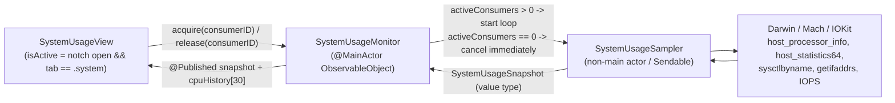

# zzz.notch — System Usage Tab Design Spec

## 1. Latar Belakang & Prinsip Desain

`zzz.notch` adalah personal macOS notch developer HUD. Saat menjalankan banyak coding agent, Docker container, atau build Xcode/Swift, sering muncul kebutuhan cepat untuk mengintip kondisi mesin (*kenapa kipas mulai kencang? apakah RAM sudah pressure? apakah download/upload masih jalan?*) tanpa harus membuka Activity Monitor atau menaruh menu bar monitor terpisah yang selalu polling di background.

Agar fitur ini **tidak menjadi bloat**, desain mengikuti 4 prinsip ketat:

1. **Zero idle overhead** — Polling **hanya** berjalan ketika `vm.notchState == .open` **dan** `coordinator.currentView == .system`. Saat notch tertutup atau berada di tab lain: 0 timer aktif, 0% CPU, tidak ada background wake-up.
2. **Minimal change, maximal result** — Memakai ulang arsitektur tab (`NotchViews`, `TabSelectionView`, `BoringHeader`), bahasa visual `DevActivityViews`, dan ukuran standar `openNotchSize` (`640 × 190 pt`) tanpa layout jump saat berpindah dari `Home` atau `Shelf`.
3. **Public macOS APIs only** — Murni Darwin/Mach/IOKit/Foundation. Tanpa dependency eksternal, tanpa spawning proses shell (`ps`/`top`), dan tanpa private SMC/HID API.
4. **Opt-in & non-intrusive** — Bisa diaktifkan/nonaktifkan di Settings (sama seperti `Shelf`) dan tidak mengubah perilaku closed-notch live activity.

---

## 2. Scope & Non-Goals (v1)

### In Scope (v1)
- **CPU**: total utilization `%`, breakdown `User` vs `System`, 1-minute load average, dan optional mini sparkline (30 titik terakhir selama tab terbuka).
- **Memory**: `used / total GB` (formula selaras Activity Monitor: `App + Wired + Compressed`), macOS **Memory Pressure** (`Normal` / `Warning` / `Critical`), plus info `Swap` saat > 0.
- **Network**: live throughput `↓` download dan `↑` upload (auto-unit `B/s`, `KB/s`, `MB/s`), nama interface aktif (`en0`, dll.), serta peak rate selama sesi intip.
- **Footer Status Strip**:
  - **Disk**: sisa ruang volume utama (`/`).
  - **Thermal**: status termal sistem (`Nominal` / `Fair` / `Serious` / `Critical`).
  - **Battery**: persentase + indikator charging / estimasi waktu (otomatis disembunyikan di Mac desktop).
  - **Quick Action**: tombol `Activity Monitor ↗` untuk inspeksi mendalam.
- **Settings**: toggle tampilkan tab, refresh interval, toggle sparkline.

### Non-Goals (v1 — Anti-Bloat Guardrails)
- **Tidak ada background polling** untuk menyimpan grafik historis panjang saat notch tertutup.
- **Tidak ada daftar Top Processes** (`proc_listallpids` + `proc_pidinfo` terhadap ratusan proses setiap detik adalah penyebab utama monitor sistem memakan CPU; delegasikan ke tombol `Activity Monitor ↗`).
- **Tidak ada sensor suhu (°C) atau fan RPM** (di Apple Silicon memerlukan private IOKit/HID/SMC API yang rapuh tiap rilis macOS).
- **Tidak ada Closed-Notch Live Activity** untuk system stats agar tidak berebut ruang dengan pixel mascots (`Dev`) dan `Music`.
- **Tidak masuk `compactMode`** (konsisten dengan kontrak `compactMode` yang player-only tanpa tab bar).

---

## 3. Desain UI & Layout

### Budget Ruang Notch Terbuka
Dari `boringNotch/sizing/matters.swift` dan `boringNotch/ContentView.swift`:
- `openNotchSize`: `640 × 190 pt`
- Padding horizontal: `openedInsets.top` (`19 × 2`) + inner padding (`12 × 2`) → **578 pt usable width**
- Header (`max(38, displayClosedNotchHeight)`) + bottom padding (`12 pt`) → **~136–140 pt usable height**

Tab `System` memakai tinggi standar `vm.notchSize.height` (`190 pt`), sehingga transisi antar `Home ↔ Shelf ↔ System` mulus tanpa perubahan ukuran jendela.

### Wireframe (578 × 136 pt)

```text
┌─────────────────────────────────────────────────────────────────────────┐
│ [🏠] [📥] [>_] [📊]          ██████████████                        [⚙]  │  ← 38pt Header
├─────────────────────────────────────────────────────────────────────────┤
│ ┌───────────────────┐  ┌───────────────────┐  ┌───────────────────┐     │
│ │ CPU          24%  │  │ MEMORY    ● Norm  │  │ NETWORK      en0  │     │
│ │ ▁▂▃▂▄▆▅▃▂▃▄▃      │  │ 16.2 / 24 GB      │  │ ↓  12.4 MB/s      │     │  ← 96pt Top Grid
│ │ ████▓░░░░░░░░░░░  │  │ ███████████░░░░░  │  │ ↑   1.8 MB/s      │     │     (3 equal cards)
│ │ U 18% · S 6% · 2.4│  │ App 11G · C 3.2G  │  │ Peak 18.2 MB/s    │     │
│ └───────────────────┘  └───────────────────┘  └───────────────────┘     │
│ ┌───────────────────────────────────────────────────────────────────┐   │
│ │ 💽 142 GB free  ·  🌡 Nominal  ·  🔋 84% ⚡       Activity Mon ↗  │   │  ← 30pt Footer Strip
│ └───────────────────────────────────────────────────────────────────┘   │
└─────────────────────────────────────────────────────────────────────────┘
```

### Visual Tokens (Selaras dengan `DevActivityViews.swift`)
| Elemen | Style |
|---|---|
| Top Metric Card (×3) | `.white.opacity(0.06)`, `RoundedRectangle(cornerRadius: 10)`, padding `10 pt`, `spacing: 8` antar kartu |
| Footer Strip | `.white.opacity(0.05)`, `RoundedRectangle(cornerRadius: 8)`, height `30 pt`, horizontal padding `10 pt` |
| Section Label (`CPU`, `MEMORY`, `NETWORK`) | `10 pt` semibold, `.tracking(0.6)`, `.foregroundStyle(.tertiary)` |
| Angka Utama | `16–18 pt` bold `.monospacedDigit()` |
| Sub-metric / Footer | `10.5–11 pt` `.monospacedDigit()`, `.foregroundStyle(.secondary)` |
| Progress Bar | `Capsule()`, height `3.5 pt`, track `.white.opacity(0.1)` (identik dengan `contextBar`) |

### Aturan Warna Semantik (Traffic-Light)
- **CPU**: `< 70%` `.white.opacity(0.85)`, `70–89%` `.yellow`, `≥ 90%` `.red`. Bar menampilkan segmen stacked `User` (accent/white) + `System` (orange).
- **Memory**: warna mengikuti **macOS Memory Pressure** (bukan raw percentage, karena macOS normal memakai RAM tinggi untuk file cache):
  - `Normal` → hijau/netral
  - `Warning` → `.yellow`
  - `Critical` → `.red`
- **Network**: `↓` `.green` (atau `.cyan`) saat aktif, `↑` `.blue` (atau `.orange`) saat aktif, `.tertiary` saat `0 B/s`.
- **Disk**: normal `.secondary`, `< 30 GB` `.yellow`, `< 15 GB` `.red`.
- **Thermal**: `Nominal` `.secondary`, `Fair` `.yellow`, `Serious` `.orange`, `Critical` `.red`.

### Penanganan Header 4 Tab (`BoringHeader` & `TabButton`)
Sisi kiri `BoringHeader` hanya punya ruang efektif sekitar `~190 pt` (karena cutout kamera di tengah `~185–200 pt`).
Saat ini setiap `TabButton` memakai `.padding(.horizontal, 15)` (`~46 pt/tab`), sehingga 4 tab (`Home`, `Shelf`, `Dev`, `System`) akan memakan `~184 pt` — terlalu mepet.

**Solusi:**
- Gunakan SF Symbol `"gauge.with.dots.needle.33percent"` untuk tab System (kontras dengan `house.fill`, `tray.fill`, `terminal.fill`).
- Buat padding horizontal `TabButton` adaptif: `15 pt` saat `visibleTabs.count <= 3`, dan `11 pt` saat `visibleTabs.count >= 4` (`4 × ~38 pt = ~152 pt`, menyisakan margin aman `~38 pt`).
- Ekstrak fungsi penentu daftar tab aktif (mis. `TabSelectionView.visibleTabs(...)`) agar `BoringHeader` dan `TabSelectionView` memakai sumber kebenaran yang sama.

---

## 4. Arsitektur & Lifecycle



### Zero-Idle-Cost Consumer Reference Counting
Karena `zzz.notch` mendukung multi-display (`DisplayMode.allDisplays`), beberapa instance `ContentView` bisa aktif bersamaan. `SystemUsageMonitor.shared` menggunakan `Set<UUID>` untuk `activeConsumers`:
- `SystemUsageView` memakai `.task(id: isActive)` dimana `isActive = (vm.notchState == .open && coordinator.currentView == .system)`.
- Saat `isActive` menjadi `true`, view memanggil `monitor.acquire(id)` dan melepaskan lewat `defer { monitor.release(id) }` ketika task dibatalkan (notch tertutup, pindah tab, atau window dihancurkan).
- Loop polling hanya berjalan selama `!activeConsumers.isEmpty`.
- **Warm-up sample**: saat start dari kondisi idle, sampler mengambil baseline CPU & network secara instan (menampilkan Memory/Disk/Thermal/Battery langsung pada `t = 0`), lalu mengambil delta pertama pada `t = 250 ms` agar angka CPU % dan Network rate langsung akurat dalam seperempat detik — baru setelah itu lanjut ke interval normal (default `1.5 s`).
- **Disk throttling**: kapasitas disk hanya dibaca saat `start()` dan diperbarui maksimal tiap `15 s` selama tab tetap terbuka.
- **Buffer reset**: ring buffer `cpuHistory` (maks 30 `Double`) dibersihkan jika tidak ada consumer selama > 10 detik, supaya buka-tutup cepat tetap mempertahankan konteks sparkline tanpa menyimpan data basi.

---

## 5. Spesifikasi Telemetry (Public Native APIs)

| Metrik | API macOS | Formula & Catatan Implementasi |
|---|---|---|
| **CPU %** | `host_processor_info(mach_host_self(), PROCESSOR_CPU_LOAD_INFO, ...)` | Hitung delta ticks `(user + nice)`, `system`, `idle` terhadap sample sebelumnya. **Wajib** panggil `vm_deallocate` pada pointer hasil Mach agar tidak memory leak. |
| **Load Avg** | `getloadavg(&loads, 3)` | Ambil `loads[0]` (1-minute load average), format 1 desimal. |
| **Memory Used** | `host_statistics64(mach_host_self(), HOST_VM_INFO64, ...)` + `ProcessInfo.physicalMemory` | `app = (internal_page_count - purgeable_count) * pageSize`, `wired = wire_count * pageSize`, `compressed = compressor_page_count * pageSize`. `used = app + wired + compressed` (selaras dengan Activity Monitor). |
| **Swap** | `sysctlbyname("vm.swapusage", ...)` | Baca `xsw_usage.xsu_used`. Hanya ditampilkan bila `> 0`. |
| **Memory Pressure** | `sysctlbyname("kern.memorystatus_vm_pressure_level", ...)` | `1 = normal`, `2 = warning`, `4 = critical`. |
| **Network ↓ / ↑** | `getifaddrs()` → `AF_LINK` → `if_data` | Filter interface `IFF_UP && IFF_RUNNING && !(IFF_LOOPBACK)` dengan prefix physical `en*` (menghindari double-counting traffic VPN `utun*` di atas `en0`). Guard counter 32-bit wraparound: `delta = new >= old ? (new - old) : 0`. **Wajib** `freeifaddrs()`. |
| **Disk Free** | `URL(fileURLWithPath: "/").resourceValues(forKeys: [.volumeAvailableCapacityForImportantUsageKey])` | Sesuai angka "Available" macOS (termasuk purgeable snapshots). |
| **Thermal** | `ProcessInfo.processInfo.thermalState` | Instant, zero-cost enum mapping. |
| **Battery** | `IOKit.ps` (`IOPSCopyPowerSourcesInfo`, `IOPSGetPowerSourceDescription`) | Baca capacity %, charging, time remaining. Return `nil` bila tidak ada internal battery (Mac desktop) → chip disembunyikan. |

---

## 6. Rencana Integrasi Codebase

### File Baru
```text
boringNotch/components/System/
├── SystemUsageModels.swift     # SystemUsageSnapshot, MemoryPressure, Byte/Speed formatters (Sendable)
├── SystemUsageSampler.swift    # Pure Mach / sysctl / getifaddrs / IOKit / FileManager readers + delta math
├── SystemUsageMonitor.swift    # @MainActor ObservableObject, consumer ref-counting, warm-up + interval loop
└── SystemUsageView.swift       # SwiftUI tab view (3 metric cards + sparkline Path + footer strip)

boringNotchTests/
└── SystemUsageTests.swift      # Unit tests (delta CPU/net, wraparound guard, memory calc, formatting)
```

### Perubahan Minimal pada File Eksisting
1. `boringNotch/enums/generic.swift` — tambah `case system` pada `enum NotchViews`.
2. `boringNotch/models/Constants.swift` — tambah `Defaults.Keys`:
   - `enableSystemTab = Key<Bool>("enableSystemTab", default: true)`
   - `systemRefreshInterval = Key<Double>("systemRefreshInterval", default: 1.5)`
   - `systemShowSparkline = Key<Bool>("systemShowSparkline", default: true)`
3. `boringNotch/components/Tabs/TabSelectionView.swift` & `TabButton.swift` — daftarkan tab `System`, filter dengan `Defaults[.enableSystemTab]`, dan padding horizontal adaptif (`11 pt` jika ≥ 4 tab).
4. `boringNotch/components/Notch/BoringHeader.swift` — tampilkan `TabSelectionView` bila `visibleTabs.count > 1` (menghindari kondisi terpisah yang bisa drift).
5. `boringNotch/ContentView.swift` — tambah `case .system: SystemUsageView()` di `NotchLayout()`.
6. `boringNotch/BoringViewCoordinator.swift` — observe `Defaults.publisher(.enableSystemTab)`: jika dimatikan saat `currentView == .system`, fallback ke `.home` (pola identik `boringShelfCancellable`).
7. `boringNotch/components/Settings/Views/DevSettingsView.swift` — tambah 1 section **System Usage** (tanpa menambah item sidebar baru di `SettingsView.swift`).
8. `boringNotch.xcodeproj/project.pbxproj` — daftarkan 4 file source baru + 1 file test baru.

---

## 7. Settings UI

Ditempatkan sebagai section **System Usage** di `Settings → Dev` agar sidebar Settings tidak makin panjang:
- **Show System Usage tab** (`Toggle`, `.enableSystemTab`)
- **Refresh interval** (`Picker`: `1s`, `1.5s`, `2s`, `3s`, `.systemRefreshInterval`, disabled saat toggle off)
- **Show CPU sparkline** (`Toggle`, `.systemShowSparkline`, disabled saat toggle off)

---

## 8. Edge Cases & Rencana Verifikasi

### Edge Cases
- **Counter overflow / interface reconnect**: `if_data.ifi_ibytes` / `ifi_obytes` bertipe `UInt32` (wrap tiap ~4 GB). Jika nilai baru lebih kecil dari baseline, delta di-clamp ke `0` (bukan underflow atau spike palsu).
- **Tab dimatikan saat sedang dibuka**: coordinator otomatis memindahkan `currentView` ke `.home`, dan `.task` di `SystemUsageView` langsung cancel + melepas consumer.
- **Notch dibuka pada mode `compactMode`**: tab bar disembunyikan dan `SystemUsageView` tidak pernah di-mount → 0 polling.
- **Mac tanpa baterai / sedang offline**: chip baterai tidak dirender; network menampilkan `Idle` + `0 B/s` tanpa error.
- **Activity Monitor launch**: membuka `/System/Applications/Utilities/Activity Monitor.app` via `NSWorkspace.shared.openApplication`, lalu menutup notch agar tidak menghalangi window baru.

### Verifikasi
1. **Unit Tests (`SystemUsageTests.swift`)**:
   - Kalkulasi delta CPU (normal, 0 delta, full load, multi-core clamping `0...100`).
   - Kalkulasi memory used & mapping pressure level (`1 / 2 / 4 / unknown`).
   - Kalkulasi network throughput & guard `UInt32` wraparound.
   - Formatting byte/speed (`0 B/s`, `512 KB/s`, `14.2 MB/s`, `16.2 GB`).
   - Ref-counting `SystemUsageMonitor` (`acquire`/`release` multi-consumer).
2. **Manual / Runtime Verification**:
   - Cek header dengan semua 4 tab aktif (`Home`, `Shelf`, `Dev`, `System`) pada layar notched & non-notched — pastikan tidak terpotong cutout kamera.
   - Pastikan saat notch ditutup atau pindah ke tab `Home`, tidak ada timer/sampling yang berjalan (cek via Activity Monitor / Instruments).
   - Verifikasi nilai CPU & Memory selaras dengan Activity Monitor saat menjalankan beban berat (mis. `xcodebuild`).

---

## 9. Pertanyaan Terbuka Sebelum Implementasi

1. **Default toggle `.enableSystemTab`**: langsung `true` (aktif otomatis setelah update) atau `false` (opt-in dari Settings)?
2. **Lokasi Settings**: nyaman ditaruh di `Settings → Dev`, atau lebih cocok di `Settings → Notch`?
3. **Interface Network**: cukup physical interfaces (`en*`) supaya bebas double-counting, atau ingin ada indikator terpisah untuk VPN (`utun*`)?
